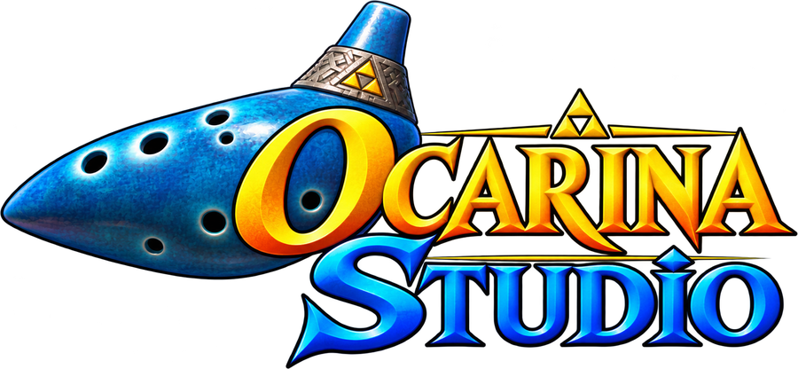

<p align="center">
  
</p>

A machinima tool for **The Legend of Zelda: Ocarina of Time**, inspired by Saturn 64 (the Super Mario 64 machinima tool) and built on top of the [Ship of Harkinian](https://github.com/HarbourMasters/Shipwright) PC port source code.

The goal is to give machinima creators the same kind of workflow Saturn 64 offers for SM64, adapted to Ocarina of Time: a clean view with no HUD, a green screen, a free camera, character customization and a pose/animation editor.

> **Status: pre-alpha.** All the features below are written, but the project has **not been compiled or played yet**. The first manual build on GitHub Actions is the first real test, so expect compile errors and bugs while that gets worked out.

---

## Features

OcarinaStudio skips the logos, the title screen and the file select. The game starts directly on a green screen with child Link and no HUD, and everything is controlled from a **menu bar at the top of the window**, like Saturn 64. **F10** hides or shows the whole interface for a clean capture.

| Menu | What it does |
| --- | --- |
| **Menu** | Open the Animator, Stage options, warp by entrance index, **Settings** (FPS, audio, fullscreen, VSync). |
| **Camera** | **Game / Frozen / Free camera** plus FOV, move speed and rotate speed. The free camera is OcarinaStudio's own, so nothing covers the shot. |
| **Appearance** | **Customize** Link's colors (tunics, hair, linen, boots) with saved palettes, **custom eyes** from PNG files, **model packs** (`.o2r`), and child / adult Link. |
| **Game** | Warp to a world (Link's House, Kokiri Forest, Hyrule Field, Temple of Time...). Warping to a world turns the green screen off. *Empty green screen stage* brings it back. Also the FPS presets (20 / 30 / 60). |
| **CHROMA KEY** | Green screen on/off, background color, hide the game HUD and message boxes. |

The game runs at **30 FPS** by default (the logic is still 20 ticks per second; the extra frames are interpolated). Change it in *Game > FPS* or *Menu > Settings*.

### OcarinaAnimator

`OcarinaAnimator` (`OcarinaAnimator.exe` on Windows, `OcarinaAnimator.sh` on Linux) is a second launcher that sits next to OcarinaStudio. It starts the same program in **Animator mode**: a green screen with Link standing still and the Animator window ready. The layout follows Saturn Studio: numeric values for every limb on the right (three fields per limb), and a timeline across the bottom with one track per limb and a diamond on every keyframe. Link is frozen on his standing pose; dragging a value keys the current frame. Scrub by clicking the ruler, play with looping, speed and linear or smooth easing. The **Animation Mixtape** lists Link's original animations (with search): *Bake into timeline* turns one into keyframes you can edit. Save and load poses and animations.

### Free camera controls

| Input | Action |
| --- | --- |
| `I` / `K` | Forward / back |
| `J` / `L` | Strafe left / right |
| `U` / `O` | Down / up |
| Right mouse button + drag | Look around |
| `Shift` / `Ctrl` | Faster / slower |

### Your data folders

OcarinaStudio keeps everything in an `OcarinaStudio` folder next to Ship of Harkinian's save data. The folders are created automatically.

| Folder | Contents |
| --- | --- |
| `OcarinaStudio/eyes/` | Your custom eye images (`.png`), resized to the original eye texture size. A **subfolder is an eye set**: name its images `open`, `half`, `closed`, `left`, `right`, `shock` (a folder with one image uses it for every slot). |
| `OcarinaStudio/palettes/` | Saved color palettes (`.json`). |
| `OcarinaStudio/models/` | Model packs (`.o2r`). |
| `OcarinaStudio/poses/` | Saved poses (`.json`). |
| `OcarinaStudio/animations/` | Saved keyframe animations (`.json`). |

### Known limitations

- **Windows and Linux only.** There is no macOS build yet.
- The free camera replaces the game camera's *output*; the game camera keeps running underneath, so cutscenes and targeting still behave normally.
- While the Animator is on, Link's controller input is disabled and the game's own animation is replaced by a frozen standing pose.
- Switching model packs reloads the current scene so Link is rebuilt with the new model.

---

## Roadmap

- [x] Machinima stage: no HUD, green screen, world selection
- [x] Freeze camera and free camera
- [x] Link colors with saved palettes
- [x] Eye expressions and custom eyes folder
- [x] Model pack switching
- [x] Pose editor and keyframe animation
- [ ] First successful build and in-game testing
- [ ] macOS build
- [ ] Camera keyframes and path playback
- [ ] Video / image-sequence capture

---

## Project layout

OcarinaStudio does not fork Ship of Harkinian's source. It is applied on top of it:

```
patches/    The few engine hooks: HUD, background, camera output, window registration
overlay/    The OcarinaStudio module, added to Ship of Harkinian as new files
assets/     Logo and application icons
scripts/    apply.sh, which applies the patches, the module and the icons
tests/      Standalone unit tests for the pose/animation math (g++, no game needed)
```

---

## Requirements

OcarinaStudio does **not** include any Nintendo game data. You need to provide your own legally obtained copy of the Ocarina of Time ROM, exactly as Ship of Harkinian requires.

---

## Credits

- [Ship of Harkinian](https://github.com/HarbourMasters/Shipwright) by HarbourMasters, the PC port this project is built on.
- Saturn 64, the inspiration for the feature set and workflow.

OcarinaStudio is a fan project and is not affiliated with or endorsed by Nintendo, HarbourMasters or the Saturn 64 team.

---

## License

The license will be defined once the Ship of Harkinian integration is confirmed, so that it respects the licenses of the upstream code.
